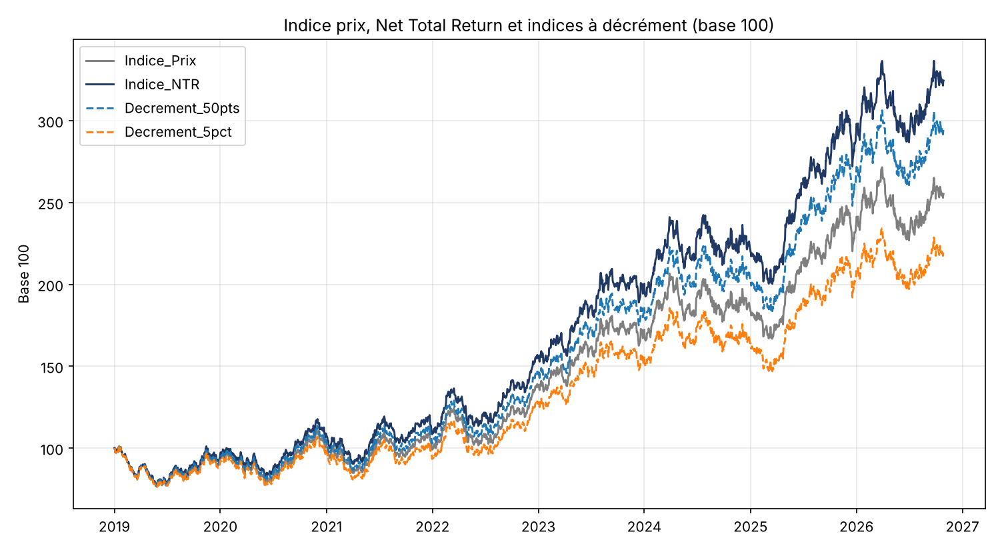

# Decrement Indices

Builds fixed-point and percentage decrement indices from a Net Total Return index and compares them with the price and NTR indices.



A decrement index removes a synthetic dividend fixed in advance from the NTR index. The issuer no longer carries dividend risk, and a decrement above realised dividends lowers the forward, which makes the options funding a fund's capital protection cheaper.

**Input:** `historique_indices.xlsx`, sheet `Historique`: A Date, B Price index, C NTR index. Folder set by `DOSSIER_DONNEES`.

```bash
python indice_decrement.py --demo
```

Code comments are in French.
