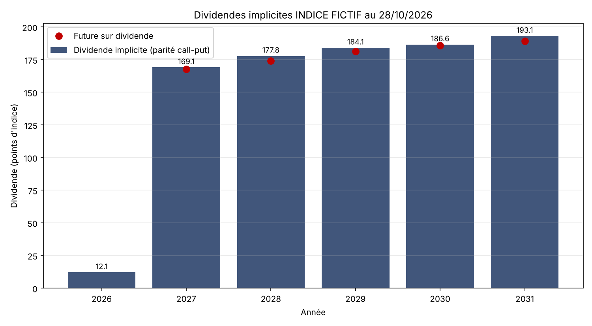

# Implied Dividends from Put-Call Parity

Extracts the market-implied dividend curve of an equity index (e.g. Euro Stoxx 50) from European option prices, year by year, and compares it with dividend futures.



## Method

For a European option with maturity T and strike K, put-call parity gives:

```
C(K) - P(K) = DF x (F - K)
```

For each maturity, `C - P` is linear in the strike. A regression across strikes gives:
- slope = `-DF` (implied discount factor, so no rate curve is needed)
- intercept = `DF x F` (discounted implied forward)

The present value of dividends paid until T is then:

```
PV(Div) = S - (DF x F) x exp(repo x T)
```

Differences between consecutive December maturities give the dividend of each year, compounded to maturity so they can be compared with dividend futures. With repo set to 0, the result is a dividend net of repo, as quoted on Delta One desks.

## Input file

Create `donnees_dividendes_implicites.xlsx` in the folder set by `DOSSIER_DONNEES` at the top of the script.

| Sheet | Content |
|---|---|
| `Parametres` | B2 underlying, B3 valuation date, B4 spot, B5 repo rate |
| `Options` | A Maturity, B Strike, C Call mid, D Put mid (headers in row 1) |
| `Dividend_Futures` (optional) | A Year, B Future price (headers in row 1) |

Use European options only, at least 5 strikes per maturity around the money, and prices taken at the same time.

## Run

```bash
pip install -r requirements.txt
python dividendes_implicites.py          # reads the Excel file
python dividendes_implicites.py --demo   # runs on synthetic data
```

The demo generates option prices from known dividends and checks that the regression recovers them.

Code comments are in French.
