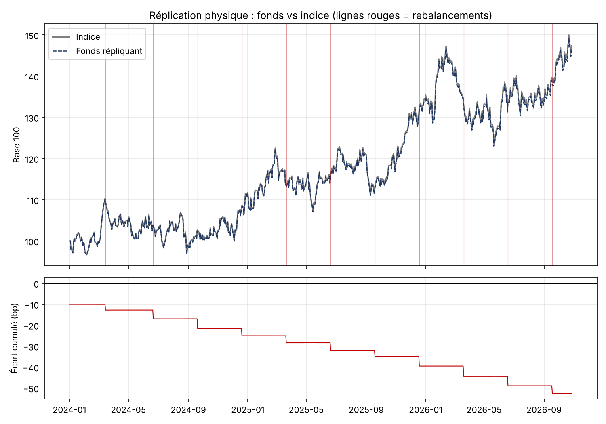

# Physical Index Replication

Simulates a fund physically replicating an equity index with quarterly rebalancing (third Friday of March, June, September, December).



- Index: target weights applied exactly, fractional quantities, no costs
- Fund: whole-share quantities, 10 bp transaction costs, weights drifting between rebalances
- Outputs: turnover and costs per rebalance, tracking difference, tracking error

**Input:** `donnees_replication.xlsx`, sheet `Prix` (A Date, one column per stock) and sheet `Poids` (A rebalancing date, one target weight column per stock). Folder set by `DOSSIER_DONNEES`.

```bash
python replication_indice.py --demo
```

Code comments are in French.
